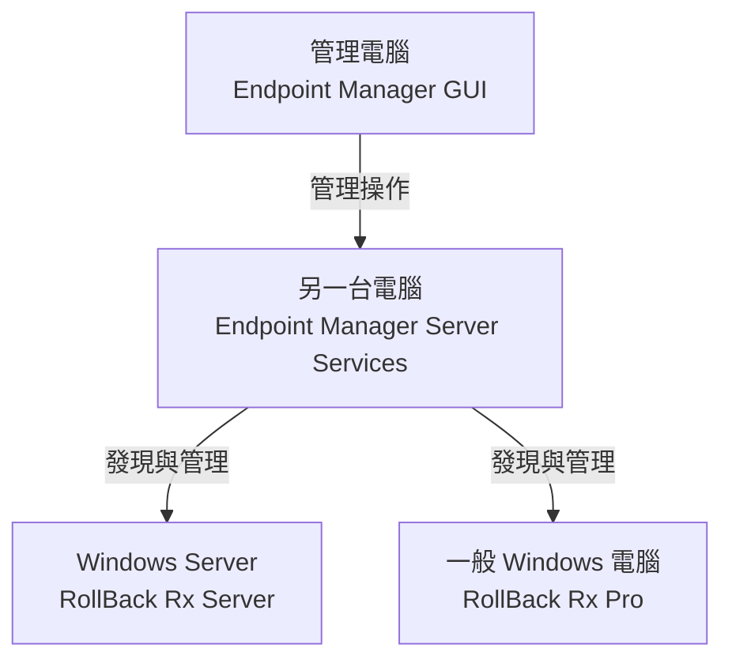

RollBack RX Pro Endpoint Manager 與 RollBack RX Server Endpoint Manager 本身無法兼容，一個能搜Endpoint 設備一個能搜Server設備，

1. 在安裝好的地方設定發現GUI

安裝 RollBack RX Pro Endpoint Manager，要修改端口要到 `C:\Program Files\RollBack Rx Server\EndPoint Manager`，修改 `Settings.ini`，把Port 給改了

